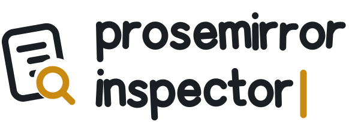
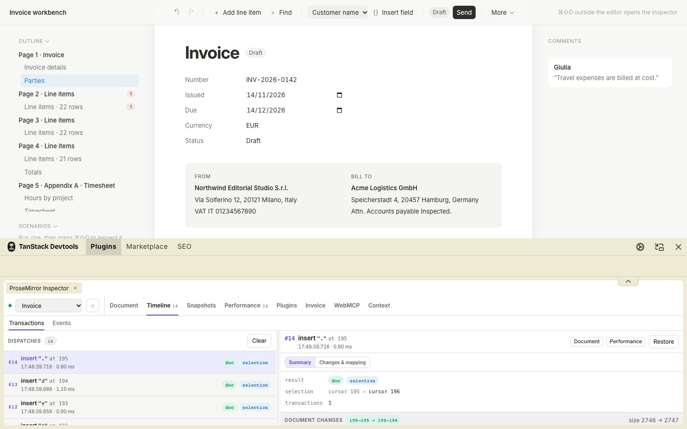
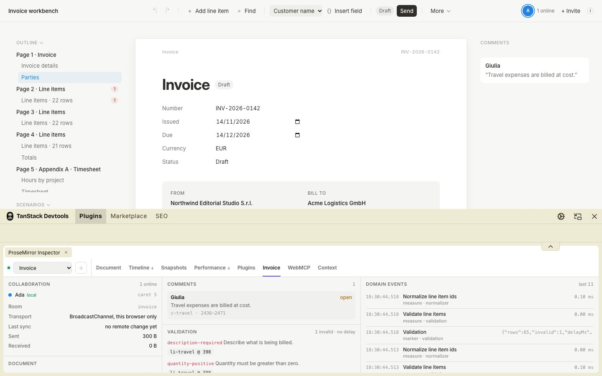
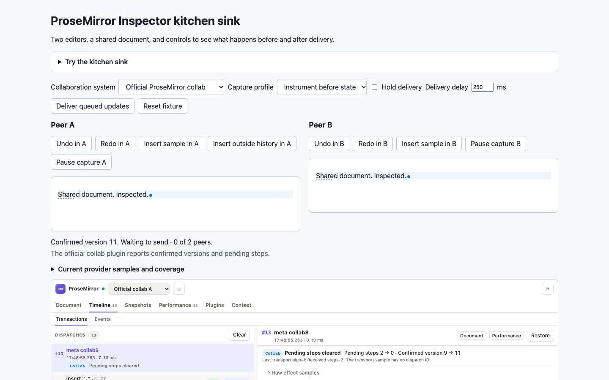
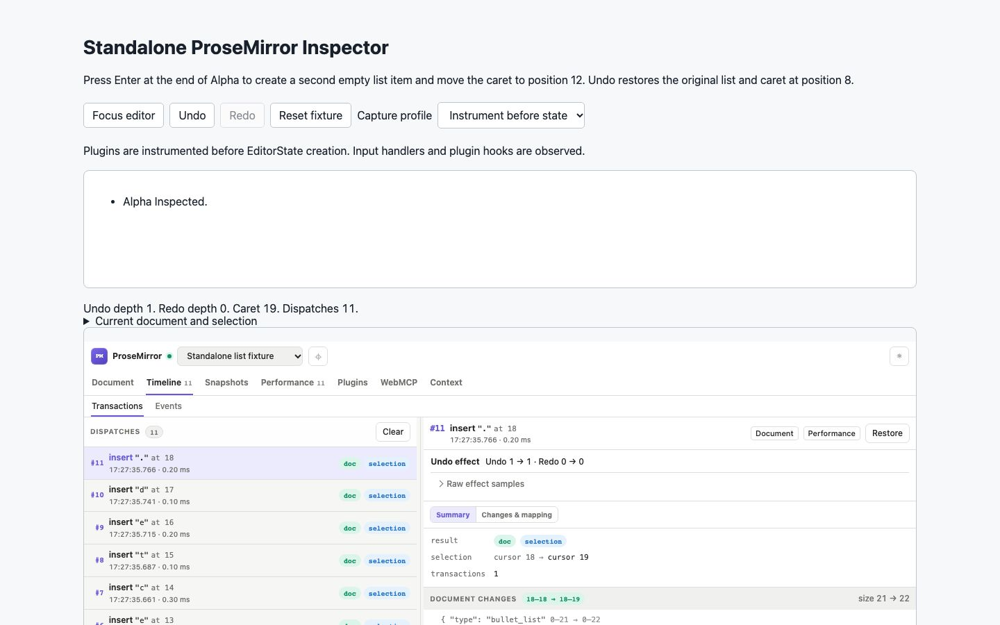

<p align="center">
  <picture>
    <source media="(prefers-color-scheme: dark)" srcset="./packages/prosemirror-devtools/assets/prosemirror-inspector-logo-dark.svg" />
    <source media="(prefers-color-scheme: light)" srcset="./packages/prosemirror-devtools/assets/prosemirror-inspector-logo-light.svg" />
    
  </picture>
</p>

<p align="center">Inspect editor state. Trace transactions. Profile plugin performance.</p>

<p align="center">
  
  <a href="./LICENSE"></a>
</p>

> **Work in progress:** this project is still under active development. APIs, integrations, and
> behavior may change between releases, including breaking changes. Feedback and bug reports are
> welcome in [GitHub Issues](https://github.com/riccardoperra/prosemirror-devtools/issues).

See what is happening inside a ProseMirror editor while you build it.

ProseMirror Inspector gives you a live view of editor state, transactions, plugins, schema, and
performance. Use the panel on its own in your application or add it to TanStack Devtools alongside
the rest of your development tools.

> ProseMirror Inspector is development-only tooling. It records editor activity and adds a small
> amount of runtime overhead.

## What you can inspect

The panel groups its views into six sections: **Document** (State, Selection, Schema),
**Timeline** (Transactions, Events), **Snapshots**, **Performance**, **Plugins** (Plugins,
Rendering) and **Context**.

- **State**. explore the document tree, selection, active marks, and document statistics.
- **Selection**. inspect anchor/head ancestry, boundaries, adjacent nodes, and marks.
- **Schema**. browse the editor's node and mark specifications.
- **Transactions**. inspect dispatches, step diffs and position mapping, and restore an earlier document.
- **Events & commands**. trace handler outcomes, nested calls, and explicitly named commands.
- **Snapshots**. save and restore documents locally or move them as JSON.
- **Performance**. compare dispatch, state-apply, view-update, and plugin-hook timings.
- **Plugins**. inspect plugin order, state, props, and the slowest plugin work.
- **Rendering**. inspect ranges, highlight positions, and follow lifecycle counters.
- **Multiple editors**. register several `EditorView` instances and switch between them in one
  panel.

The same panel works in two ways:

- **Standalone**, rendered wherever it fits in your development UI.
- **Inside TanStack Devtools**, as a native plugin that follows the host theme and layout.

The new inspection client, standalone mount, recording, and agent APIs below are available in
workspace builds of this branch. Their npm release is pending. Build the repository before running
the native examples.

## Getting started

Install the package in an application that already uses ProseMirror:

```sh
npm install --save-dev prosemirror-inspector
```

Create a devtools session before you create the editor. Plugin instrumentation is optional, but it
is what makes per-plugin timings available.

```ts
import { EditorState } from "prosemirror-state";
import { EditorView } from "prosemirror-view";
import { createProseMirrorDevtoolsSession } from "prosemirror-inspector/core";

const devtools = import.meta.env.DEV
  ? createProseMirrorDevtoolsSession({
      id: "main-editor",
      label: "Main editor",
      captureProfile: "bounded",
    })
  : null;

const plugins = devtools ? devtools.instrumentPlugins(rawPlugins) : rawPlugins;
const state = EditorState.create({ schema, plugins });
const view = new EditorView(document.querySelector("#editor")!, { state });

devtools?.attach(view);

// When the editor is removed:
devtools?.dispose();
view.destroy();
```

Here, `schema` and `rawPlugins` are your existing editor configuration. Run this setup only in
development. If you do not need plugin timings, pass `rawPlugins` directly to `EditorState.create`
and attach the completed view.

### Mount a panel without a framework

```ts
import { mountProseMirrorDevtools } from "prosemirror-inspector/standalone";

const panel = mountProseMirrorDevtools(container, { defaultPanel: "state" });
panel.update({ defaultPanel: "history", theme: "dark" });
panel.unmount();
```

The mount uses the shared panel and is inactive outside development. It does not attach an editor.

### Show it through a framework adapter

This React example renders the panel directly in the application. Matching panel adapters are
available for Preact, Solid, Vue, Svelte, and Angular.

```tsx
import { ProseMirrorDevtoolsPanel } from "prosemirror-inspector/react";

export function EditorDevtools() {
  return (
    <aside style={{ height: 480 }}>
      <ProseMirrorDevtoolsPanel defaultPanel="state" />
    </aside>
  );
}
```

### Add it to TanStack Devtools

Install the TanStack Devtools package for your framework, then create a ProseMirror plugin for its
shell:

```sh
npm install --save-dev @tanstack/react-devtools
```

```tsx
import { TanStackDevtools } from "@tanstack/react-devtools";
import { createProseMirrorDevtoolsPlugin } from "prosemirror-inspector/react";

const prosemirrorDevtools = createProseMirrorDevtoolsPlugin({
  defaultOpen: false,
});

export function App() {
  return <TanStackDevtools plugins={[prosemirrorDevtools]} />;
}
```

Use `prosemirror-inspector/preact`, `/solid`, `/vue`, `/svelte`, or `/angular` with the
matching TanStack Devtools package.

## Integrations

ProseMirror Inspector works with ProseMirror directly and includes framework adapters for React,
Preact, Solid, Vue, Svelte, and Angular. A dedicated Tiptap 3 integration handles Tiptap's editor
lifecycle and transaction middleware.

For Tiptap setup, isolated stores, panel extensions, custom performance markers, and the complete
API reference, read the [package guide](./packages/prosemirror-devtools/README.md).

Events and rendering diagnostics are opt-in. Enable `diagnostics: true` or `{ limit: 200 }` on a
devtools session, then use its `instrumentPlugins` and `attach` methods. Capture is bounded
separately from transaction history. See the [diagnostics setup](./packages/prosemirror-devtools/README.md#optional-event-and-rendering-diagnostics)
and the [inspection reference](./docs/inspection.md).

Use the [support matrix](./docs/support-matrix.md) to choose an editor integration, host, and
capture profile. Read the [agent validation guide](./docs/agent-validation.md) for the three shipped
skills, read-only tools, and experimental Chrome discovery bridge. The
[query reference](./docs/inspection-queries.md) comes from the runtime catalogue.

Use the [recording guide](./docs/recordings.md) to share bounded evidence and inspect it offline.

The [product roadmap](./docs/product-roadmap.md) records the design. The
[execution ledger](./docs/roadmap/execution.md) records delivery and verification. New capabilities
on this branch are unreleased until the next package release.

## Examples

Every example runs on [GitHub Pages](https://riccardoperra.github.io/prosemirror-devtools/) with
the inspector enabled in a production build. Start with the
[invoice workbench](https://riccardoperra.github.io/prosemirror-devtools/invoice/) or the
[kitchen sink](https://riccardoperra.github.io/prosemirror-devtools/kitchen-sink/) to try
collaboration, undo and redo, rendering diagnostics, recordings, and agent tools.

| Invoice workbench                                                                  | Invoice tab                                                                            |
| ---------------------------------------------------------------------------------- | -------------------------------------------------------------------------------------- |
|    |                 |
| **Kitchen sink**                                                                   | **Standalone**                                                                         |
|  |  |

The monorepo keeps one private example per framework so each adapter can be run and tested in its
native environment:

- Kitchen sink, collaboration and Yjs: [demo](https://riccardoperra.github.io/prosemirror-devtools/kitchen-sink/) · [source](./examples/kitchen-sink)
- Standalone ProseMirror, list and undo: [demo](https://riccardoperra.github.io/prosemirror-devtools/standalone/) · [source](./examples/standalone)
- Native Tiptap: [demo](https://riccardoperra.github.io/prosemirror-devtools/tiptap/) · [source](./examples/tiptap)
- Multi-page Tiptap invoice with inspector scenarios: [demo](https://riccardoperra.github.io/prosemirror-devtools/invoice/) · [source](./examples/invoice)
- Controlled React ProseMirror: [demo](https://riccardoperra.github.io/prosemirror-devtools/react-prosemirror/) · [source](./examples/react-prosemirror)
- React and TanStack: [demo](https://riccardoperra.github.io/prosemirror-devtools/tanstack/) · [source](./examples/tanstack)
- Preact: [demo](https://riccardoperra.github.io/prosemirror-devtools/preact/) · [source](./examples/preact)
- Solid: [demo](https://riccardoperra.github.io/prosemirror-devtools/solid/) · [source](./examples/solid)
- Vue: [demo](https://riccardoperra.github.io/prosemirror-devtools/vue/) · [source](./examples/vue)
- Svelte: [demo](https://riccardoperra.github.io/prosemirror-devtools/svelte/) · [source](./examples/svelte)
- Angular: [demo](https://riccardoperra.github.io/prosemirror-devtools/angular/) · [source](./examples/angular)

`pnpm build:pages` builds the site into `pages-dist/`. `pnpm screenshots` checks every page in a
browser and regenerates the images in `site/screenshots/`. To add an example to the site, add a
row to `scripts/examples.mjs`.

## License

[MIT](./LICENSE) © 2026 [Riccardo Perra](https://github.com/riccardoperra).
